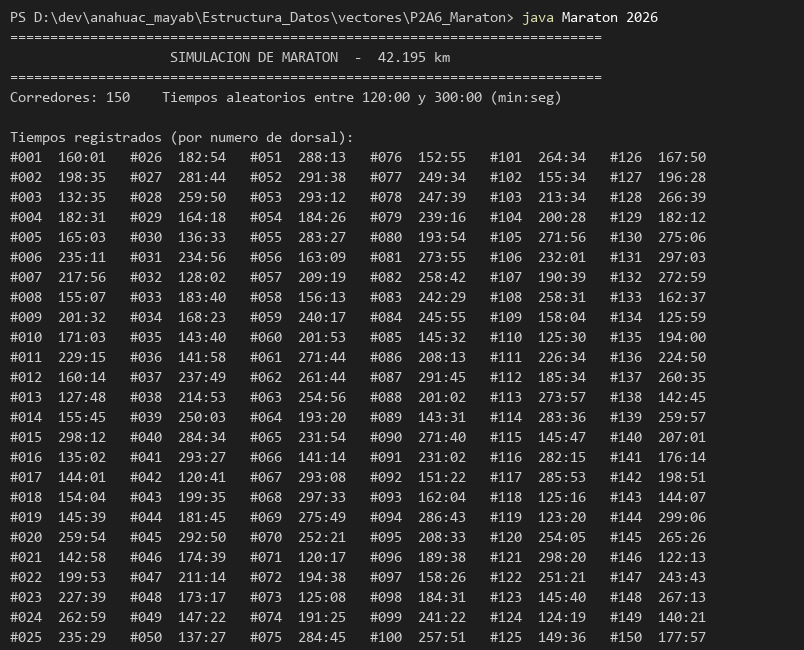
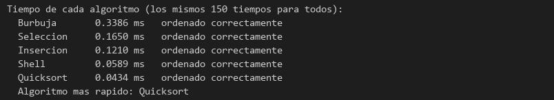
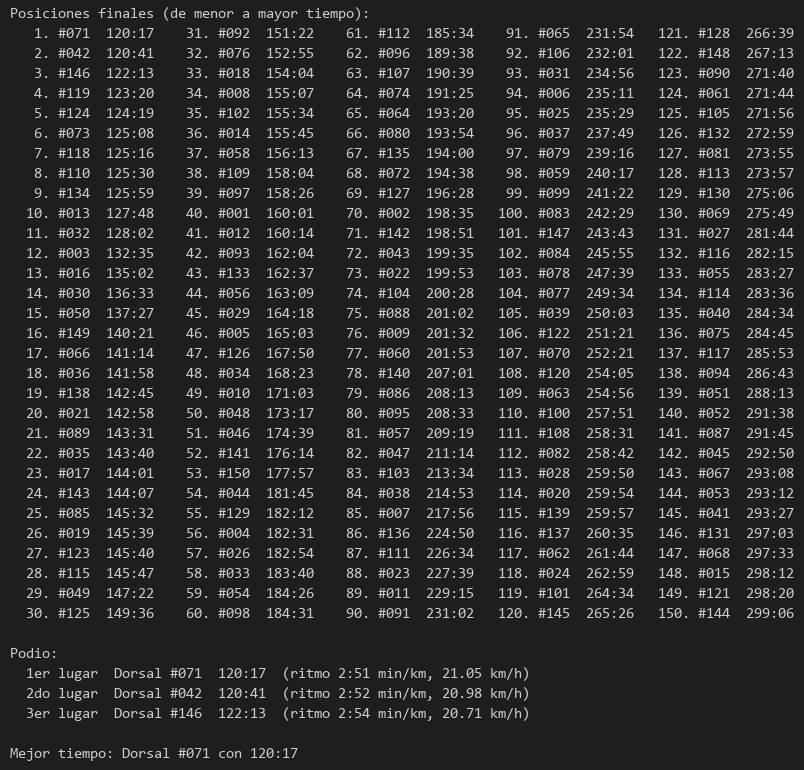
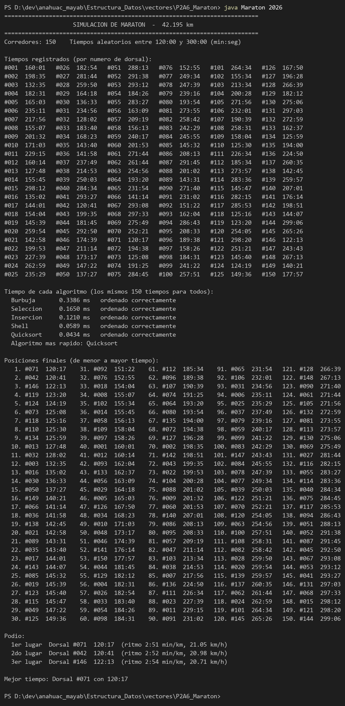

# P2A6 Maratón

Actividad de Estructura de Datos y Algoritmos.

Programa en Java que simula un maratón de **150 corredores**, genera al azar el tiempo de cada uno (entre 120 y 300 minutos, mostrado en `min:seg`), los ordena de menor a mayor para sacar las posiciones finales y **mide cuánto tarda cada algoritmo de ordenamiento**:

1. Burbuja
2. Selección
3. Inserción
4. Shell
5. Quicksort

## Estructura

```
P2A6_Maraton/
├── README.md
├── assets/          capturas de las pruebas
└── Maraton.java
```

## Compilar y ejecutar

```bash
javac Maraton.java && java Maraton
```

Sin argumentos, los tiempos cambian en cada ejecución. Con una semilla salen siempre los mismos, que es como se tomaron las capturas:

```bash
java Maraton 2026
```

`javac` compila el código y genera los archivos `.class`, que son los que Java ejecuta. Esos archivos no se editan ni se suben al repositorio; el que se modifica es `Maraton.java`.

---

## Fase 1. Los corredores y sus tiempos

```java
static class Corredor {
    int dorsal;
    int tiempo; // en segundos
}
```

Cada corredor guarda su **dorsal** (1 a 150) y su **tiempo en segundos**. Guardo segundos y no minutos para poder comparar y ordenar con números enteros; el formato `min:seg` solo se usa al imprimir.

```java
static final int MIN_SEGUNDOS = 120 * 60;
static final int MAX_SEGUNDOS = 300 * 60;

int tiempo = MIN_SEGUNDOS + azar.nextInt(MAX_SEGUNDOS - MIN_SEGUNDOS + 1);
```

`nextInt(n)` da un número de `0` a `n - 1`, así que el tiempo queda entre 7200 s (120:00) y 18000 s (300:00), incluyendo los dos extremos.

```java
static String minSeg(int segundos) {
    return String.format("%d:%02d", segundos / 60, segundos % 60);
}
```

La división entera da los minutos y el residuo (`%`) los segundos. `%02d` pone el cero a la izquierda: `7385 s -> 123:05`.



---

## Fase 2. Los 5 algoritmos

Todos ordenan el arreglo de corredores comparando `tiempo`, de menor a mayor. Al intercambiar se mueve el corredor completo, así cada tiempo sigue pegado a su dorsal.

### Burbuja

```java
while (limite > 1 && intercambio) {
    intercambio = false;
    for (int j = 0; j < limite - 1; j++) {
        if (a[j].tiempo > a[j + 1].tiempo) {
            // intercambiar a[j] y a[j + 1]
            intercambio = true;
        }
    }
    limite--;
}
```

Compara vecinos y los intercambia si están al revés. En cada pasada el más lento llega al final, por eso `limite` baja en 1. Si en una pasada no hubo intercambios, ya está ordenado y se detiene (igual que en P2A5).

### Selección

```java
for (int i = 0; i < n - 1; i++) {
    int menor = i;
    for (int j = i + 1; j < n; j++) {
        if (a[j].tiempo < a[menor].tiempo) {
            menor = j;
        }
    }
    // intercambiar a[i] y a[menor]
}
```

Busca el menor tiempo de lo que falta por ordenar y lo pone en la posición `i`. Hace pocos intercambios, pero siempre recorre todo lo que falta.

### Inserción

```java
for (int i = 1; i < a.length; i++) {
    Corredor actual = a[i];
    int j = i - 1;
    while (j >= 0 && a[j].tiempo > actual.tiempo) {
        a[j + 1] = a[j];
        j--;
    }
    a[j + 1] = actual;
}
```

Toma cada corredor y lo mete en su lugar dentro de la parte de la izquierda, que ya está ordenada, recorriendo a la derecha los que tienen más tiempo.

### Shell

```java
intervalo = n / 2;
while (intervalo > 0) {
    for (i = intervalo; i < n; i++) {
        j = i - intervalo;
        while (j >= 0) {
            k = j + intervalo;
            if (a[j].tiempo <= a[k].tiempo) {
                j = -1;
            } else {
                // intercambiar a[j] y a[k]
                j -= intervalo;
            }
        }
    }
    intervalo = intervalo / 2;
}
```

Es el código de la clase: en vez de comparar vecinos compara elementos separados por un **intervalo** (75, 37, 18, 9, 4, 2, 1 para 150 corredores). Así los tiempos se acercan rápido a su lugar y la última pasada (intervalo 1) casi no tiene que mover nada.

### Quicksort

```java
central = (primero + ultimo) / 2;
pivote = a[central].tiempo;
do {
    while (a[i].tiempo < pivote) i++;
    while (a[j].tiempo > pivote) j--;
    if (i <= j) {
        // intercambiar a[i] y a[j]
        i++;
        j--;
    }
} while (i <= j);
if (primero < j) quicksort(a, primero, j);
if (i < ultimo) quicksort(a, i, ultimo);
```

También como en clase: toma de **pivote** el tiempo del elemento central, deja a la izquierda los menores y a la derecha los mayores, y luego se llama a sí mismo con cada mitad (divide y vencerás).

---

## Fase 3. Medir el tiempo de cada algoritmo

```java
for (int alg = 0; alg < ALGORITMOS.length; alg++) {
    Corredor[] copia = registro.clone();
    long inicio = System.nanoTime();
    ordenar(alg, copia);
    nanos[alg] = System.nanoTime() - inicio;
}
```

- Cada algoritmo ordena una **copia** de los mismos 150 tiempos (`clone()`), para que todos empiecen con el mismo desorden y la comparación sea justa.
- `System.nanoTime()` se toma justo antes y justo después de ordenar; la diferencia se muestra en milisegundos.
- Antes de medir, cada algoritmo se corre una vez de "calentamiento": la primera vez que Java ejecuta un método es más lento porque todavía no lo optimiza, y eso le habría sumado tiempo al primero de la lista.
- Después de ordenar se revisa con `estaOrdenado` que de verdad quedó de menor a mayor.

Resultado de la prueba con `java Maraton 2026`:



- **Burbuja** fue el más lento (0.3386 ms) y **Quicksort** el más rápido (0.0434 ms), casi 8 veces menos.
- Selección e Inserción quedan en medio: son `O(n²)` como Burbuja, pero hacen menos intercambios.
- Shell y Quicksort son los métodos avanzados que vimos en clase y se nota: tardan una fracción de los otros tres.
- Los números cambian un poco en cada ejecución (depende de la computadora), pero el orden se mantiene.

---

## Fase 4. Posiciones finales y podio

Con el arreglo ya ordenado, la posición de cada corredor es su lugar en el arreglo + 1. Se imprimen los 150 en columnas y al final el podio, con el ritmo por kilómetro (`tiempo / 42.195`) y la velocidad promedio en km/h.



En esta prueba ganó el dorsal **#071 con 120:17**, a un ritmo de 2:51 min/km (21.05 km/h).

### Ejecución completa


