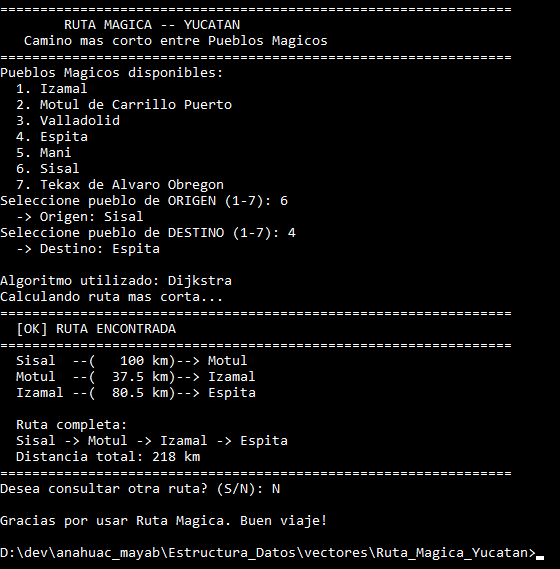
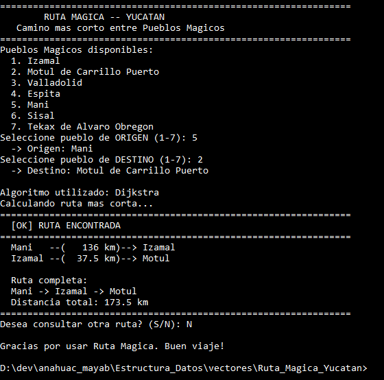
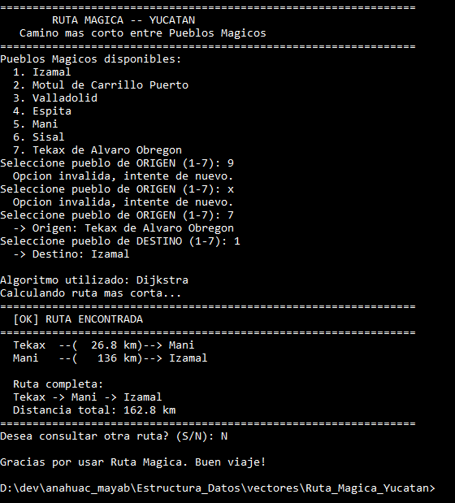

# Ruta Mágica — Yucatán

Proyecto de grafos de Estructura de Datos y Algoritmos.

Programa en Java que modela los **Pueblos Mágicos de Yucatán** como un grafo **no dirigido y ponderado** (los pesos son kilómetros de carretera) y encuentra el camino más corto entre dos pueblos que elige el usuario, usando el **algoritmo de Dijkstra**.

Pueblos Mágicos incluidos (los 7 del estado):

1. Izamal
2. Motul de Carrillo Puerto
3. Valladolid
4. Espita
5. Maní
6. Sisal
7. Tekax de Álvaro Obregón

## Estructura

```
Ruta_Magica_Yucatan/
├── README.md
├── assets/                capturas de las pruebas
├── pueblos_yucatan.txt    el grafo: carreteras y distancias
├── Arista.java            una carretera hacia otro pueblo
├── Grafo.java             lista de adyacencia y lectura del archivo
├── Dijkstra.java          algoritmo de camino más corto
└── RutaMagica.java        menú principal (main)
```

## Compilar y ejecutar

```bash
javac *.java && java RutaMagica
```

Hay que ejecutarlo dentro de la carpeta `Ruta_Magica_Yucatan`, porque ahí está `pueblos_yucatan.txt`. También se le puede pasar otro archivo: `java RutaMagica otro_estado.txt`.

`javac` compila el código y genera los archivos `.class`, que son los que Java ejecuta. Esos archivos no se editan ni se suben al repositorio; los que se modifican son los `.java`.

---

## Fase 1. El grafo: pueblos y carreteras

Cada pueblo es un **vértice** y cada carretera directa entre dos pueblos es una **arista** con peso igual a su distancia en km.

Las distancias son reales: las saqué de **Google Maps** con la ruta recomendada en coche entre cada par de pueblos. Solo puse carreteras entre pueblos que son "vecinos" en el mapa; no conecté todos con todos, porque entonces el camino más corto siempre sería ir directo y el algoritmo no tendría nada que decidir.

El grafo se guarda en `pueblos_yucatan.txt`, con el formato que pide el proyecto (`origen destino km`):

```
# Pueblos Magicos de Yucatan -- Distancias en km (Google Maps, ruta recomendada)
Izamal Motul 37.5
Izamal Valladolid 110
Izamal Espita 80.5
Izamal Mani 136
Motul Sisal 100
Motul Espita 124
Valladolid Espita 51.2
Valladolid Tekax 164
Sisal Mani 159
Mani Tekax 26.8
```

Así se ve el grafo:

```
          Sisal ---100--- Motul ---124--- Espita
            |               |          /    |
           159            37.5     80.5   51.2
            |               |     /         |
          Mani ----136---- Izamal ---110--- Valladolid
            |                                  |
          26.8                                 |
            |                                  |
          Tekax -------------164---------------+
```

El grafo es **no dirigido**: las carreteras se pueden recorrer en los dos sentidos y la distancia es la misma de ida y de vuelta, así que no hay razón para que sea dirigido.

---

## Fase 2. Representación: lista de adyacencia

Elegí **lista de adyacencia** (`Map<String, List<Arista>>`) en lugar de matriz, porque el grafo es **disperso**: 7 pueblos y solo 10 carreteras. Una matriz de 7×7 tendría 49 casillas y la mayoría estaría en infinito; la lista solo guarda las carreteras que sí existen.

### Arista

```java
public class Arista {
    private String destino;
    private double distancia;

    public Arista(String destino, double distancia) {
        this.destino = destino;
        this.distancia = distancia;
    }
    ...
}
```

Una arista guarda **a dónde llega** y **cuántos km** mide. No hace falta guardar el origen, porque la arista ya está dentro de la lista de su pueblo de origen.

### Agregar una carretera

```java
public void agregarCarretera(String a, String b, double km) {
    agregarPueblo(a);
    agregarPueblo(b);
    adyacencia.get(a).add(new Arista(b, km));
    adyacencia.get(b).add(new Arista(a, km));
}
```

- Si el pueblo no existe todavía, `agregarPueblo` le crea su lista vacía (`putIfAbsent`).
- La carretera se agrega **en los dos sentidos** (`a -> b` y `b -> a`), porque el grafo es no dirigido.
- Uso `LinkedHashMap` para que los pueblos salgan en el menú en el mismo orden en que aparecen en el archivo.

### Leer el grafo desde el archivo

```java
while ((linea = lector.readLine()) != null) {
    linea = linea.trim();
    if (linea.isEmpty() || linea.startsWith("#")) {
        continue;
    }
    String[] partes = linea.split("\\s+");
    grafo.agregarCarretera(partes[0], partes[1], Double.parseDouble(partes[2]));
}
```

- Las líneas vacías y las que empiezan con `#` (comentarios) se ignoran.
- Cada línea se separa por espacios: origen, destino y km.
- Así se puede cambiar de estado o agregar carreteras sin tocar el código, solo editando el `.txt`.

---

## Fase 3. Elección del algoritmo: Dijkstra

El proyecto deja elegir entre Dijkstra, Floyd-Warshall y Bellman-Ford. Elegí **Dijkstra** por estas razones:

- **Todos los pesos son positivos.** Son distancias en km; no existe una carretera de "-20 km". Dijkstra funciona correctamente cuando no hay pesos negativos.
- **Bellman-Ford no hace falta.** Su ventaja es que acepta pesos negativos, pero aquí no hay. Además es más lento: `O(V·E)` contra `O((V + E) log V)` de Dijkstra.
- **Floyd-Warshall calcula de más.** Saca las distancias entre **todos** los pares de pueblos (`O(V³)`) y usa una matriz `V×V`. El usuario solo pide una ruta a la vez (un origen y un destino), así que basta con calcular desde un solo origen.
- **El grafo es disperso**, que es justo donde Dijkstra con cola de prioridad y lista de adyacencia funciona mejor.

---

## Fase 4. Implementación de Dijkstra

### Inicialización

```java
for (String pueblo : grafo.getPueblos()) {
    distancia.put(pueblo, Double.POSITIVE_INFINITY);
}
distancia.put(origen, 0.0);
```

- Al inicio no se sabe llegar a ningún pueblo, así que todos empiezan en **infinito**.
- El origen empieza en **0**, porque ya estamos ahí.
- `anterior` guarda, para cada pueblo, desde qué pueblo se llegó por el mejor camino. Sirve para reconstruir la ruta al final.

### Cola de prioridad

```java
PriorityQueue<Object[]> cola = new PriorityQueue<>((x, y) -> Double.compare((double) x[1], (double) y[1]));
cola.add(new Object[] { origen, 0.0 });
```

La cola siempre saca primero el pueblo con **menor distancia acumulada**. Esa es la idea de Dijkstra: el pueblo más cercano que todavía no se ha procesado ya tiene su distancia final, porque cualquier otro camino pasaría por pueblos más lejanos.

### Relajación

```java
while (!cola.isEmpty()) {
    Object[] actual = cola.poll();
    String pueblo = (String) actual[0];
    double dist = (double) actual[1];
    if (dist > distancia.get(pueblo)) {
        continue;
    }
    for (Arista a : grafo.getVecinos(pueblo)) {
        double nueva = dist + a.getDistancia();
        if (nueva < distancia.get(a.getDestino())) {
            distancia.put(a.getDestino(), nueva);
            anterior.put(a.getDestino(), pueblo);
            cola.add(new Object[] { a.getDestino(), nueva });
        }
    }
}
```

- Para cada vecino se prueba: ¿es más corto llegar a él **pasando por el pueblo actual**? Si sí, se actualiza su distancia y su `anterior`, y se mete a la cola.
- Un pueblo puede entrar varias veces a la cola con distancias distintas. El `if (dist > distancia.get(pueblo)) continue;` descarta las entradas viejas que ya no son las mejores.

### Reconstruir la ruta

```java
for (String p = destino; p != null; p = anterior.get(p)) {
    ruta.add(p);
}
Collections.reverse(ruta);
```

Se camina hacia atrás desde el destino siguiendo `anterior` hasta llegar al origen (que no tiene anterior), y luego se invierte la lista para que quede de origen a destino. Si la distancia del destino sigue en infinito, no hay ruta y se regresa la lista vacía.

---

## Fase 5. Programa principal

`RutaMagica.java` arma el menú con el formato que pide el proyecto:

1. Carga el grafo desde `pueblos_yucatan.txt`.
2. Muestra los Pueblos Mágicos numerados.
3. Pide el pueblo de **origen** y de **destino** por número.
4. Corre Dijkstra desde el origen.
5. Imprime cada tramo de la ruta con sus km, la ruta completa y la distancia total.
6. Pregunta si se quiere consultar otra ruta (`S/N`).

### Validación de la entrada

```java
private static String pedirPueblo(Scanner sc, List<String> pueblos, String tipo) {
    while (true) {
        System.out.print("Seleccione pueblo de " + tipo + " (1-" + pueblos.size() + "): ");
        String entrada = sc.nextLine().trim();
        try {
            int opcion = Integer.parseInt(entrada);
            if (opcion >= 1 && opcion <= pueblos.size()) {
                return pueblos.get(opcion - 1);
            }
        } catch (NumberFormatException e) {
        }
        System.out.println("  Opcion invalida, intente de nuevo.");
    }
}
```

Si el usuario escribe un número fuera de rango o algo que no es número, el programa no truena: avisa y vuelve a preguntar.

### Nombres completos

En el archivo los pueblos van con nombre corto y sin espacios (`Motul`, `Tekax`), porque el formato separa por espacios. En el menú se muestran con su nombre completo (`Motul de Carrillo Puerto`, `Tekax de Alvaro Obregon`) usando un `Map` de nombres.

---

## Fase 6. Pruebas

### Prueba 1. Sisal → Espita

El camino que parece obvio es `Sisal -> Motul -> Espita` (100 + 124 = **224 km**), porque Motul tiene carretera directa a Espita. Dijkstra encuentra uno más corto pasando por Izamal: `Sisal -> Motul -> Izamal -> Espita` = **218 km**. Tiene más tramos, pero son 6 km menos.



### Prueba 2. Maní → Motul de Carrillo Puerto

Maní está al sur y Motul al norte. Las opciones son ir por Sisal (159 + 100 = 259 km) o por Izamal (136 + 37.5 = **173.5 km**). Dijkstra elige Izamal.



### Prueba 3. Validación de entrada y Tekax → Izamal

Primero se escriben opciones inválidas (`9` y `x`) y el programa vuelve a preguntar. Después se calcula Tekax → Izamal: por Maní son 26.8 + 136 = **162.8 km**, contra 164 + 110 = 274 km por Valladolid.


